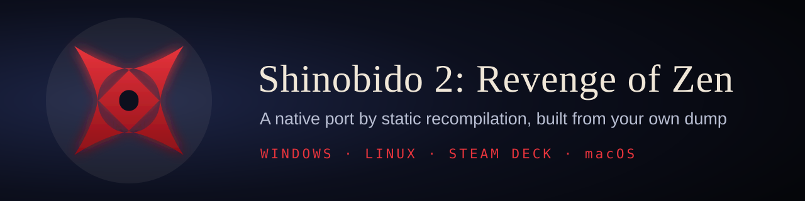
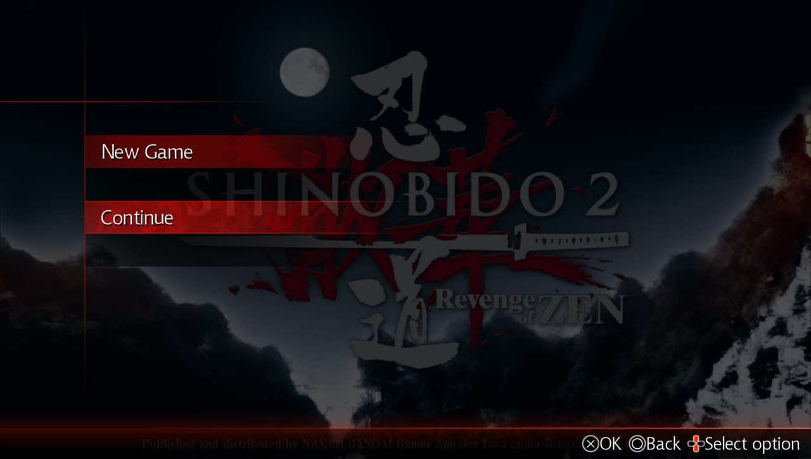
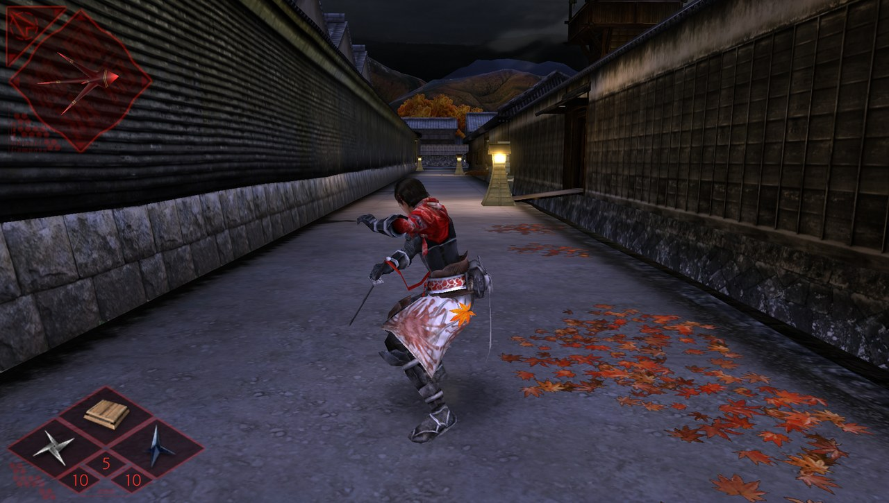
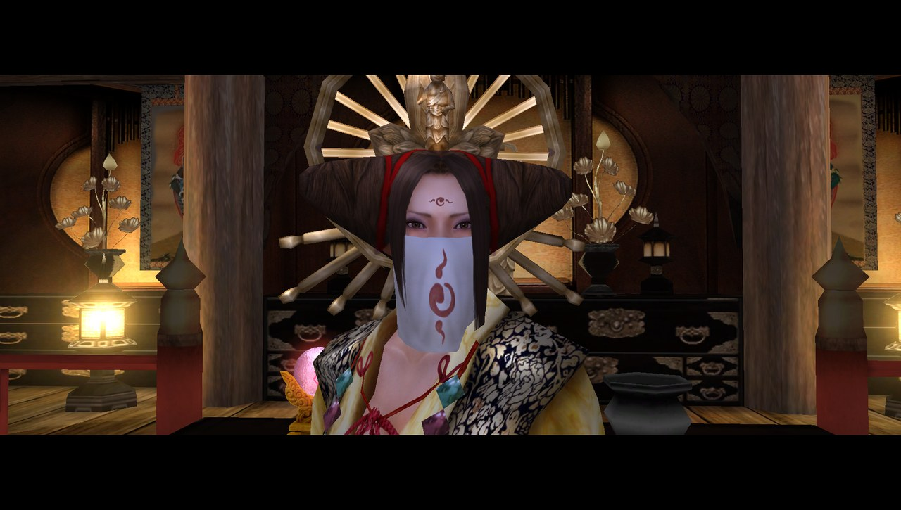
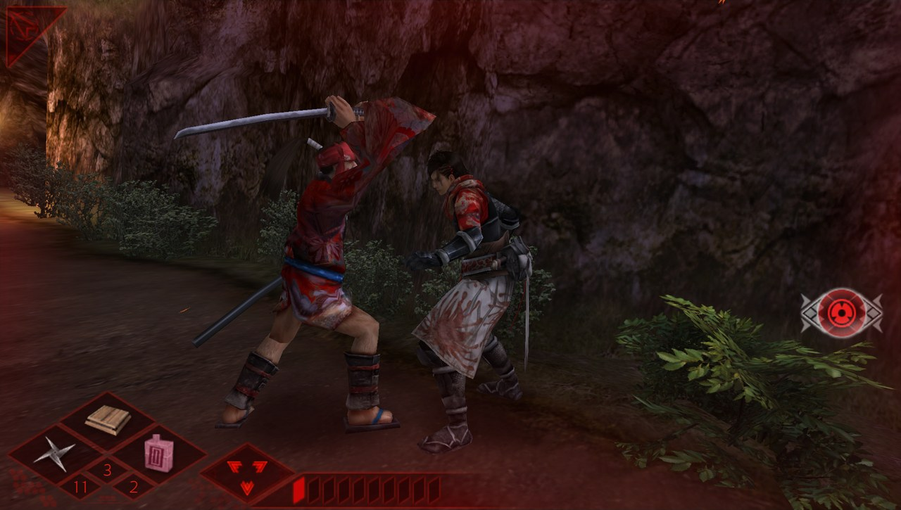

**A native port of Shinobido 2: Revenge of Zen (PS Vita) to Windows, Linux and the Steam Deck, macOS and Android, by static recompilation.**

**[Download the latest release](https://github.com/vita-recomps/utakata/releases/latest)** ·
[Installation guide](docs/INSTALLING.md) ·
[Build from source](docs/BUILDING.md) ·
[Compatibility](docs/06-compatibility.md) ·
[Report an issue](https://github.com/vita-recomps/utakata/issues)

## About

utakata runs **Shinobido 2: Revenge of Zen** (PS Vita, US PCSE00015,
update 1.02) natively. The game's code, and the firmware modules it loads,
are recompiled ahead of time to C++ and run natively inside a fork of
Vita3K, which supplies the rest of the console. Utakata is the land the
game is set in.

> This repository and its releases contain *no* game data, *no* firmware and
> *no* code derived from the game, apart from the README's
> [screenshots](#screenshots). You bring your own dump; everything
> game-derived is generated on your computer from it. See
> [D2](docs/decisions.md) and [D12](docs/decisions.md).

## Status

The whole story plays to the ending on native code, without a JIT, and the
Mirror Spirits add-on's missions load and play; checked on AMD and NVIDIA
GPUs ([compatibility](docs/06-compatibility.md)). Other endings and
difficulties than the one played through are untested.

It runs on four platforms, each on native code:

* **Windows** 10 or 11, x64;
* **Linux** x64, the **Steam Deck** among them (desktop mode to set up,
  then Game Mode to play);
* **macOS** 13.3 or newer on **Apple Silicon** (M1 and later, tested on an
  M5);
* **Android** 9 or newer on 64-bit ARM with Vulkan, made for Snapdragon
  handhelds (tested on an AYN Thor, at 60 fps at 2× too), since 0.2.0. The
  app builds the game on the device from your dump: no PC needed.

## Features

Compared with running the game in Vita3K:

* **Native code.** The game's code, and the firmware modules it loads, are
  recompiled ahead of time to C++ and run natively; the build ships without
  the JIT. Each module is checked against the game in memory before its
  native code runs.
* **Sound effects that last.** In Vita3K the game's sound effects go silent
  after a few missions: its sound manager waits for voices to finish
  fading, and Vita3K never reported it. The fork tracks the fades, so no
  voice is lost; reverb and fade-outs are implemented too (Phase 5 in the
  [plan](docs/03-plan.md)).
* **60 fps.** `frame_rate = 60` runs missions at 60 fps at the right
  speed, by changing the game's frame pacing as data in memory, with no
  code patch. Menus, the hub, mission results and the scenes that step
  per frame stay at 30 so they keep their speed. Known: the HUD and pause
  menu animate twice as fast at 60. The default, 30, is the Vita's rate.
* **No texture shimmer.** Many ground textures ship without mipmaps and
  shimmer in motion, on a Vita too. The fork builds the mipmaps at load
  time, on by default ([D8](docs/decisions.md)).
* **Higher resolution**: Vita3K's multiplier, tested at 2× (1920×1088).
* **An in-game settings menu** (F1, or Select held on a gamepad) over the
  paused game, and a commented `shinobido2.ini`.
* **The caution eye on a key:** F or the right trigger touches the eye
  that locks on to an enemy, wherever it is on screen; the mouse is the
  touchscreens.
* **Vita saves** imported and exported (`--import-save`, `--export-save`).
* **Language:** the game's English, French or Spanish text, chosen in the
  settings menu.
* **Mouse camera** on a PC (Tab or a middle click captures the cursor),
  turning the camera as far as the mouse moves.
* **Xbox button prompts:** A, B, X, Y, LB, RB, Menu and View in the
  game's prompts, its HUD and its controls page, or whichever the
  connected gamepad has.
* **Cheats** in the settings menu: infinite health and ninja tools,
  one-hit kills, maximum money and stats. All off by default.
* **Skip the intro logos** as an option; **rePatch mods**, beside the
  game's own files; and a `recomplauncher.json` for
  [RecompLauncher](https://recomplauncher.com).
* **One program** per platform (`shinobido2.exe`, `shinobido2.x86_64`, the
  macOS app), without Vita3K's interface and offline, which builds itself
  from your own dump on its first start, in its own folder.
* **Android:** an app that builds the game on the device (about 8 minutes
  on a Snapdragon 8 Gen 2), or takes it from a PC that built it
  (`--android`). The handheld's own buttons as a gamepad; on a phone, the
  Vita's buttons and sticks on the touchscreen, with a crouch toggle and
  the caution eyes by finger. A long press on the icon adds the add-on or
  imports a Vita save. Turnip, the open-source Adreno driver, is offered on
  Snapdragon devices.

## Download and play

Download the archive for your system from the
**[latest release](https://github.com/vita-recomps/utakata/releases/latest)**.
It unpacks to the game's folder, `utakata`, with one program to start:

| System | Download | Start |
|---|---|---|
| Windows 10/11, x64 | `utakata-<version>-windows.zip` | `shinobido2.exe` |
| Linux x64, Steam Deck | `utakata-<version>-linux.tar.gz` | `shinobido2.x86_64` |
| macOS 13.3+, Apple Silicon | `utakata-<version>-macos.tar.gz` | `Shinobido 2 - Revenge of Zen.app` |
| Android 9+, 64-bit ARM | `utakata-<version>-android.apk` | **Shinobido 2** (install the APK) |

The first start builds the game from your own dump of it (the US game with
update 1.02; the Mirror Spirits add-on is optional): its importer asks for
the dump, downloads the PS Vita firmware from Sony and a compiler, and
compiles the game's code on your computer (or Android device), in a few
minutes. From then on
the program goes straight to the game. Everything stays in that folder
([D11](docs/decisions.md)), and the command line covers everything
(`--help`).

The **[installation guide](docs/INSTALLING.md)** has the details for each
system: what dumps work, the Steam Deck's Game Mode, macOS's Gatekeeper,
Android, saves, files, command-line options and updating. To build it yourself, see
**[BUILDING](docs/BUILDING.md)**.

## Documentation

| Doc | Contents |
|---|---|
| [INSTALLING](docs/INSTALLING.md) | for players: requirements, each system, the first start, saves, files, command line |
| [BUILDING](docs/BUILDING.md) | building from source, installing a game into a build, making a release, the toolchain and tools |
| [01-research](docs/01-research.md) | the dump, the FADEBABE archives, the eboot measured, prior work |
| [02-baseline](docs/02-baseline.md) | how the game behaves today, the SFX dropout repro, and how to re-run it |
| [03-plan](docs/03-plan.md) | phases, exit criteria, risks |
| [06-compatibility](docs/06-compatibility.md) | what has been played and checked, and what not yet |
| [decisions](docs/decisions.md) | decision log |
| [hashes](docs/hashes.md) | input hashes and pins |

utakata shares its recompiler, tools and Vita3K fork with
[ss-delta](https://github.com/vita-recomps/ss-delta) (Soul Sacrifice
Delta), whose docs hold most of the know-how.

## Licence

MIT ([LICENSE](LICENSE)). The Vita3K fork it builds on
(`third_party/vita3k`) is GPL-2.0-or-later.

## Screenshots

Taken from the port at 2× resolution (1920×1088, scaled down here), on
native code.

| | |
|---|---|
|  |  |
| The main menu | A night alley in the first mission |
|  |  |
| The opening scene of the second-to-last mission | A fight, at low health |
